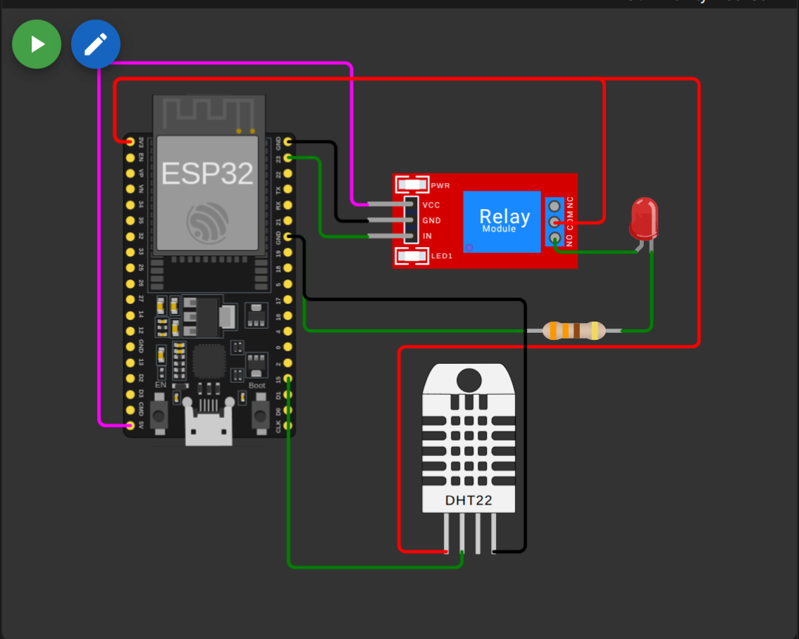
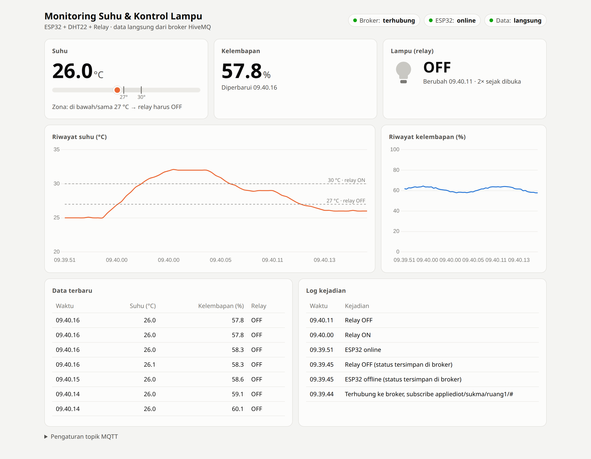

# Tugas 3 — Sistem Monitoring Suhu dan Kontrol Lampu Berbasis IoT

ESP32 DevKit V1 + DHT22 + Modul Relay 1 Channel + MQTT (HiveMQ), disimulasikan di Wokwi.

| File                           | Isi                                                                      |
| ------------------------------ | ------------------------------------------------------------------------ |
| `sketch.ino`                   | Program utama ESP32 (Arduino C++)                                        |
| `hysteresis.h`                 | Logika ambang suhu 30 °C / 27 °C                                         |
| `diagram.json`                 | Rangkaian Wokwi                                                          |
| `libraries.txt`                | Library Wokwi: PubSubClient, DHT sensor library, Adafruit Unified Sensor |
| `dashboard/index.html`         | Dashboard web langsung dari broker, tanpa instalasi (tugas tambahan)     |
| `README.md`                    | Deskripsi proyek (juga untuk tab README di Wokwi)                        |
| `wokwi.toml`, `platformio.ini` | Konfigurasi simulasi Wokwi di VS Code                                    |

**Tautan proyek Wokwi:** <https://wokwi.com/projects/479588366008869889>

## Menjalankan di VS Code

1. Pasang ekstensi **Wokwi Simulator** dan **PlatformIO IDE**, lalu aktifkan lisensi Wokwi (`F1` → _Wokwi: Request a New License_).
2. Buka folder proyek ini (root repositori) sebagai _workspace_ (file `wokwi.toml` dan `diagram.json` harus berada di root folder yang dibuka).
3. Build firmware: tombol ✓ _PlatformIO: Build_ atau `pio run`. Hasilnya `.pio/build/esp32dev/firmware.bin`/`.elf`, sesuai path di `wokwi.toml`.
4. `F1` → **Wokwi: Start Simulator**. Klik sensor DHT22 di jendela simulasi untuk mengubah suhu.
5. Setiap kode diubah, build ulang lalu jalankan ulang simulator.

---

## A. Perancangan Rangkaian

### Tabel koneksi

| Komponen | Pin komponen | Pin ESP32            | Fungsi                              |
| -------- | ------------ | -------------------- | ----------------------------------- |
| DHT22    | VCC          | 3V3                  | Catu daya sensor                    |
| DHT22    | SDA (data)   | **GPIO 15**          | Jalur data suhu/kelembapan (1-wire) |
| DHT22    | GND          | GND                  | Referensi ground                    |
| Relay    | VCC          | VIN (5 V)            | Catu daya modul relay               |
| Relay    | GND          | GND                  | Referensi ground                    |
| Relay    | IN           | **GPIO 23**          | Sinyal kontrol relay                |
| Relay    | COM          | 3V3                  | Sumber tegangan beban (lampu)       |
| Relay    | NO           | Anoda LED            | Beban tersambung saat relay ON      |
| LED      | Katoda       | Resistor 220 Ω → GND | Pembatas arus lampu                 |

Lampu (LED) menyala ketika relay ON karena kontak COM–NO tertutup.



---

## B. Pemrograman ESP32

### Topik MQTT (broker `broker.hivemq.com:1883`)

| Topik                            | Arah           | Payload                                        | Keterangan                                                   |
| -------------------------------- | -------------- | ---------------------------------------------- | ------------------------------------------------------------ |
| `appliediot/sukma/ruang1/suhu`   | ESP32 → broker | `{"suhu":31.0,"kelembapan":60.0,"relay":"ON"}` | Dikirim tiap 2 detik                                         |
| `appliediot/sukma/ruang1/relay`  | ESP32 → broker | `ON` / `OFF`                                   | Hanya saat status berubah, _retained_                        |
| `appliediot/sukma/ruang1/online` | ESP32 → broker | `online` / `offline`                           | Status koneksi, `offline` dikirim broker sebagai _Last Will_ |

### Penjelasan bagian kode

| Bagian                                             | Fungsi                                                                                                         |
| -------------------------------------------------- | -------------------------------------------------------------------------------------------------------------- |
| `#include <WiFi.h>`, `<PubSubClient.h>`, `<DHT.h>` | Library WiFi, klien MQTT, dan sensor DHT                                                                       |
| Konstanta `ssid`, `mqtt_server`, `topic_*`         | Konfigurasi WiFi Wokwi, broker HiveMQ, dan nama topik                                                          |
| `RELAY_PIN 23`, `DHT_PIN 15`                       | Pin GPIO relay dan sensor                                                                                      |
| `SENSOR_INTERVAL = 2000`                           | Pembacaan tiap 2 detik (DHT22 hanya mampu ±0,5 Hz)                                                             |
| `nextRelayState()` (`hysteresis.h`)                | ≥ 30 °C → ON, ≤ 27 °C → OFF, di antaranya → status sebelumnya dipertahankan                                    |
| `setRelay()`                                       | Menulis GPIO 23 hanya jika status berubah, lalu menandai status perlu dikirim                                  |
| `publishRelayState()`                              | Mengirim status relay (retained). Jika MQTT sedang putus, pengiriman ditunda sampai tersambung lagi            |
| `readSensor()`                                     | Membaca DHT22, mengecek `isnan` (sensor gagal), menjalankan kontrol relay, lalu publish JSON                   |
| `maintainWifi()`                                   | Menyambung ulang WiFi tiap 5 detik **tanpa** `while`/`delay` yang memblokir                                    |
| `maintainMqtt()`                                   | Menyambung ulang MQTT tiap 5 detik, memasang _Last Will_ `offline`, publish `online`                           |
| `loop()`                                           | Penjadwal berbasis `millis()`: jaga koneksi → `client.loop()` → baca sensor bila waktunya → kirim status relay |

Perbedaan utama terhadap program praktikum sebelumnya: `delay()` dan `while (!connected)` diganti penjadwalan `millis()`, sehingga pembacaan sensor dan kontrol relay **tetap berjalan** walaupun WiFi/MQTT sedang putus (ketentuan B.9).

---

## C. Pengujian Sistem

Cara uji: jalankan simulasi, klik sensor DHT22 di Wokwi, geser nilai _temperature_ sesuai urutan tabel, amati LED, Serial Monitor, dan pesan di MQTTX (subscribe `appliediot/sukma/ruang1/#`).

| No. | Suhu uji | Kondisi relay yang diharapkan | Hasil aktual | Pesan MQTT `.../relay` | Sesuai? |
| --- | -------- | ----------------------------- | ------------ | ---------------------- | ------- |
| 1   | 25 °C    | Mati (kondisi awal mati)      | OFF          | — (tidak berubah)      | ✔       |
| 2   | 30 °C    | Menyala                       | ON           | `ON`                   | ✔       |
| 3   | 32 °C    | Tetap menyala                 | ON           | —                      | ✔       |
| 4   | 29 °C    | Tetap menyala                 | ON           | —                      | ✔       |
| 5   | 27 °C    | Mati                          | OFF          | `OFF`                  | ✔       |
| 6   | 26 °C    | Tetap mati                    | OFF          | —                      | ✔       |

> Kolom "Hasil aktual" di atas berasal dari uji logika `hysteresis.h` dengan urutan suhu yang sama (semua lulus). **Cocokkan kembali dengan simulasi Wokwi** dan lampirkan tangkapan layarnya.

Contoh keluaran Serial Monitor yang diharapkan:

```text
Suhu: 29.9 C | Kelembapan: 60.0 %
MQTT -> appliediot/sukma/ruang1/suhu : {"suhu":29.9,"kelembapan":60.0,"relay":"OFF"}
Suhu: 30.0 C | Kelembapan: 60.0 %
Relay ON (suhu 30.0 C)
MQTT -> appliediot/sukma/ruang1/suhu : {"suhu":30.0,"kelembapan":60.0,"relay":"ON"}
MQTT -> appliediot/sukma/ruang1/relay : ON
```

`<<sisipkan tangkapan layar Serial Monitor + LED untuk tiap baris uji>>`

---

## D. Pertanyaan Analisis

**1. Apa fungsi sensor DHT22 dalam sistem?**
DHT22 adalah sumber data sistem: mengukur suhu (−40…80 °C, akurasi ±0,5 °C) dan kelembapan udara, lalu mengirimkannya secara digital lewat satu jalur data ke GPIO 15. Nilai suhu ini dipakai untuk dua hal: dikirim ke broker MQTT sebagai data monitoring, dan menjadi masukan logika kontrol yang menentukan relay (lampu) menyala atau mati.

**2. Bagaimana ESP32 mengirim data suhu melalui MQTT?**
ESP32 tersambung ke WiFi `Wokwi-GUEST`, lalu `PubSubClient` membuka koneksi TCP ke `broker.hivemq.com:1883` dengan client ID unik. Setiap 2 detik ESP32 membaca DHT22, menyusun payload JSON `{"suhu":..,"kelembapan":..,"relay":".."}`, lalu memanggil `client.publish()` ke topik `appliediot/sukma/ruang1/suhu`. Broker meneruskan pesan ke semua klien yang subscribe ke topik itu (MQTTX, dashboard web). `client.loop()` di setiap putaran `loop()` menjaga koneksi (keep-alive) dan memproses paket masuk.

**3. Mengapa memakai dua ambang (30 °C dan 27 °C), bukan satu?**
Dengan satu ambang (misal 30 °C), suhu yang berfluktuasi di sekitar 30 °C (29,9 → 30,0 → 29,9 …, termasuk derau sensor) membuat relay bolak-balik ON/OFF berkali-kali (_chattering_). Akibatnya kontak relay cepat aus, lampu berkedip, dan broker dibanjiri pesan status. Dengan dua ambang (_hysteresis_), relay baru ON di ≥ 30 °C dan baru OFF lagi setelah suhu turun ≤ 27 °C. Pita 3 °C di tengah menjadi "zona mati" yang mempertahankan status sebelumnya, sehingga perubahan kondisi hanya terjadi saat suhu benar-benar berubah signifikan.

**4. Apa yang terjadi jika Wi-Fi atau MQTT terputus?**

- Kontrol lokal tetap berjalan: pembacaan DHT22 dan keputusan relay ada di ESP32 dan tidak bergantung pada jaringan, jadi lampu tetap dikendalikan otomatis.
- Karena tidak ada `delay`/`while` yang memblokir, ESP32 mencoba menyambung ulang WiFi dan MQTT tiap 5 detik di latar belakang.
- Data suhu selama terputus tidak terkirim (tidak di-_buffer_). Namun perubahan status relay ditandai belum terkirim (`relayStatePublished = false`) dan dikirim begitu MQTT tersambung kembali, sehingga dashboard mendapat status terbaru.
- Broker mengirim pesan _Last Will_ `offline` ke `.../online` jika ESP32 hilang tanpa memutus koneksi dengan benar. Setelah tersambung lagi ESP32 mengirim `online`. Dashboard jadi tahu perangkat sedang tidak terhubung.

**5. Bagaimana mengembangkan sistem agar suhu dan status relay dapat dipantau lewat dashboard?**
Karena data sudah ada di broker MQTT, dashboard cukup menjadi _subscriber_ tambahan tanpa mengubah firmware. Contohnya dashboard web pada bagian Tugas Tambahan: halaman HTML subscribe ke topik suhu, relay, dan status perangkat lewat MQTT over WebSocket, lalu menampilkannya sebagai angka, grafik riwayat, dan indikator status. Alternatif lain: ThingsBoard/Thinger.io/Blynk (dengan menyesuaikan format pesan atau menggunakan bridge), menyimpan data ke database deret waktu (InfluxDB) lalu divisualisasikan di Grafana, serta menambah topik `.../relay/set` agar lampu juga bisa dikendalikan manual dari dashboard.

---

## Tugas Tambahan — Dashboard Web

File: `dashboard/index.html`

Halaman HTML tunggal yang subscribe langsung ke HiveMQ lewat MQTT over WebSocket (`wss://broker.hivemq.com:8884/mqtt`, library MQTT.js) dan menggambar grafik dengan Chart.js. Tidak perlu instalasi: cukup buka file di browser saat simulasi Wokwi berjalan.

Isi dashboard:

- Status koneksi broker, status ESP32 (online/offline dari Last Will), dan indikator data terlambat (> 10 detik tanpa data)
- Suhu dengan pita zona hysteresis (penanda 27 °C dan 30 °C), kelembapan, dan indikator lampu ON/OFF beserta jumlah perubahannya
- Grafik riwayat suhu (dengan garis ambang 27/30 °C) dan kelembapan, 5 menit terakhir
- Tabel data terbaru dan log kejadian (relay berubah, ESP32 online/offline)
- Prefix topik bisa diganti dari bagian _Pengaturan topik MQTT_ (disimpan di browser)



_Data pada tangkapan layar ini dikirim oleh publisher uji yang meniru ESP32 (format pesan dan topik sama, urutan suhu mengikuti tabel pengujian: 25 → 30 → 32 → 29 → 27 → 26 °C). Grafik memperlihatkan hysteresis: relay ON saat suhu mencapai 30 °C, tetap ON di 29 °C, dan baru OFF di 27 °C._

---

## Kesimpulan

1. ESP32 berhasil membaca suhu DHT22 secara berkala dan mengirimkannya ke broker MQTT HiveMQ dalam format JSON.
2. Relay (lampu) dikendalikan otomatis dengan hysteresis 30 °C / 27 °C. Keenam skenario uji menghasilkan kondisi relay sesuai harapan, dan status relay hanya dikirim saat berubah.
3. Penjadwalan berbasis `millis()` dan penyambungan ulang yang tidak memblokir membuat kontrol suhu tetap berjalan walaupun jaringan terputus.
4. Karena memakai MQTT (publish/subscribe), data mudah ditampilkan di dashboard web tanpa mengubah program ESP32.
